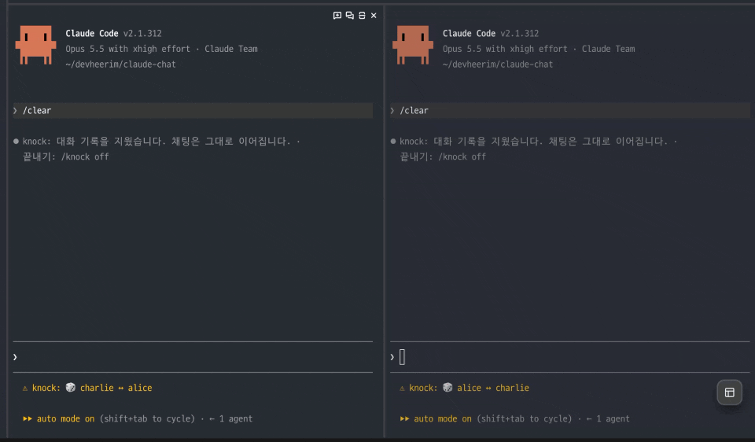

# knock 🚪

[English](README.md) | 한국어

**Claude Code를 떠나지 않고 친구와 채팅합니다.**
내가 입력한 말은 친구에게 전달되고, 친구의 답장은 Claude 답변 자리에 표시됩니다. 모델을 호출하지 않으므로 토큰이 들지 않습니다.



| 시간 | alice 화면 | bob 화면 |
| --- | --- | --- |
| 12:01 | `❯ 점심 ㄱ?` | |
| 12:01 | | `⏺ 점심 ㄱ?` |
| 12:03 | | `❯ 국밥 ㄱㄱ 5분 뒤 1층` |
| 12:03 | `⏺ 국밥 ㄱㄱ 5분 뒤 1층` | |

`❯`는 내가 입력한 말이고, `⏺`는 친구가 보낸 말입니다. 친구의 말은 Claude 답변 자리에 표시됩니다.

## 빠른 시작

```
/plugin install knock --marketplace Henry-Hong/knock
/knock
```

1. Claude Code에 설치합니다. `Add marketplace?`가 뜨면 `y`를 누릅니다.
2. `/knock`을 입력합니다. 메뉴가 열리고 이름 정하기부터 안내합니다.
3. **친구에게 노크**를 고르고 친구 이름을 입력합니다. 친구도 나에게 노크하면 연결됩니다 💬

익숙해지면 `/knock bob`으로 바로 노크하고, `/knock off`로 끝낼 수 있습니다.

## 명령어

외울 명령은 `/knock` 하나입니다. 그대로 입력하면 메뉴가 열리고, 뒤에 단어를 붙이면 그 일을 바로 합니다. `/knock ` 뒤에 글자를 입력하기 시작하면 자동완성이 단어, 최근 친구와 방, 색 이름을 보여 줍니다.

| 명령 | |
| --- | --- |
| `/knock` | 메뉴: 친구에게 노크, 아무나 만나기, 방 들어가기, 내 설정 |
| `/knock <이름>` | 친구에게 노크. 서로 노크하면 연결됩니다 |
| `/knock random [코드]` | 랜덤으로 아무나 만나기. 코드를 붙이면 같은 코드를 입력한 사람끼리만 만납니다 |
| `/knock next` | 지금 랜덤 상대와 끊고 다음 상대 찾기 |
| `/knock room [방이름]` | 여러 명이 함께 쓰는 방에 들어가기 (최대 8명). 이름 없이 입력하면 지금 방의 참가자를 보여 줍니다 |
| `/knock block [이름]` | 지금 대화 상대(또는 이름) 차단하기 |
| `/knock me` | 내 설정: 이름 색(미리 보기와 함께), 이름, 언어. `/knock me color 파랑`, `/knock me name <이름>`, `/knock me lang ko`로 바로 바꿀 수도 있습니다 |
| `/knock pic paste` | 복사한 사진을 채팅이나 방에 보내기 (macOS) |
| `/knock pic <파일.png>` | PNG 파일로 보내기. `/knock pic`만 입력하면 받은 사진을 보여 줍니다 |
| `/knock off` | 연결을 끊거나 방에서 나와(또는 상대 찾기를 그만두고) Claude로 돌아가기 |

예전의 `/knock-room` 같은 명령도 그대로 동작하지만, 자동완성 목록에는 나오지 않습니다.

## 알아두면 좋은 점

- **노크 알림은 상대가 knock 창을 열어 둔 경우에만 전달됩니다.** 알림이 전달되지 않았다면 노크할 때 알려 드립니다. 이때는 친구에게 직접 알려 주세요.
- **연결되어 있는 동안에는 스피너가 계속 돌아갑니다.** 상대의 답장을 기다리고 있다는 뜻입니다.
- **채팅 내용은 그 창의 Claude 대화 기록에 남습니다.** 작업 중인 창보다는 새 창에서 채팅하는 것을 권장합니다.
- **실수로 창을 닫았다면** 상대가 10분 동안 기다립니다. 새 창에서 `/knock`을 열고 맨 위 줄에서 Enter를 누르세요.
- **knock은 영어나 한국어로 안내합니다.** 기본은 영어입니다. `/knock`의 첫 화면이나 `/knock me`에서 한국어를 고르거나, `/knock me lang ko`를 입력하세요. 이 컴퓨터의 모든 창에 적용됩니다.

## 더 알아보기

<details>
<summary><b>설치</b></summary>

- 셸에서 설치: `claude plugin install knock --marketplace Henry-Hong/knock`
- Claude Code 2.1.311 이상에서 확인했습니다. 버전이 낮다면 먼저 `claude update`를 실행해 주세요.
- 메시지가 도착하면 knock이 턴을 열면서 `📨` 줄을 추가합니다. 함께 설치되는 `knock-view`가 이 줄을 가려 줍니다.
- 업데이트: `claude plugin update knock`

</details>

<details>
<summary><b>노크 알림은 언제 전달되나요</b></summary>

`🚪 alice 님이 노크했습니다` 알림은 상대가 **노크를 기다리는 창**을 열어 둔 경우에만 표시됩니다. 누군가에게 노크해 둔 창이나 채팅 중인 창이 여기에 해당합니다. 작업 중인 다른 창마다 알림이 뜨면 방해가 되므로 이렇게 설계했습니다.

- 노크하면 알림이 전달되었는지 바로 알려 드립니다.
- 알림이 전달되지 않아도 노크는 유지됩니다. 내 창이 기다리는 동안 친구가 `/knock`을 입력하면 노크한 사람 목록에서 나를 확인할 수 있습니다.

</details>

<details>
<summary><b>화면에 표시되는 것</b></summary>

- **`› Prompt from the knock plugin`**: 아무 작업도 하지 않을 때 친구의 메시지가 도착하면 knock이 대신 턴을 엽니다. 이때 Claude Code가 붙이는 라벨이며, 플러그인이 지울 수 없습니다. 이어지는 메시지는 같은 턴에 쌓이므로 라벨은 한 번만 표시됩니다.
- **하단 상태줄**: `💬 alice ↔ bob`은 연결된 상태이고, `⏳ alice → bob`은 상대가 노크해 주기를 기다리는 상태입니다. `🎲`는 랜덤으로 만난 상대이거나, 대기실에서 상대를 찾는 중이라는 뜻입니다. `👥 alice · 점심팟 3/8`은 3명이 있는 방에 들어가 있다는 뜻입니다.
- **`/knock` 맨 위 줄**: `alice · 연결 없음 · 지금 knock 3명 · 오늘 41명`
  - *지금*은 대화 중이거나, 노크하고 기다리거나, 대기실이나 방에 있는 사람 수입니다. 나는 세지 않습니다. Claude Code만 켜 둔 사람은 세지 않습니다. 그런 사람에게는 노크해도 알림이 가지 않기 때문입니다.
  - *오늘*은 최근 24시간 동안 knock를 쓴 사람 수입니다. 나도 포함됩니다.
- **Esc**: 채팅 턴이 중단되고 Claude Code가 `Interrupted`를 표시합니다. 채팅을 끝낼 때는 `/knock off`를 사용하는 것이 깔끔합니다.
- **채팅 중 `/clear`**: 화면과 Claude 대화 기록만 지워지고 채팅은 그대로 이어집니다. 내 이름과 대화 상대(또는 방)도 유지됩니다.
- **대화 중에 창이 닫히거나 끊겼을 때**: 창을 닫거나, 노트북이 잠자기에 들어가거나, 네트워크가 끊겨도 대화가 아주 끝나지는 않습니다.
  - 상대 창에 그 사실이 표시되고, 10분 동안 돌아오기를 기다립니다. 그동안 상대가 입력하는 내용은 Claude에게 가고, `/knock off`로 기다리기를 그만둘 수 있습니다.
  - 잠자기에서 깨어나거나 네트워크가 돌아온 창은 알아서 대화를 다시 잇습니다. 방이나 대기실도 마찬가지입니다.
  - 새 창에서는 `/knock` 맨 위 줄에 `🔁 bob 님과 다시 연결 · 나를 기다리는 중`이 표시됩니다. Enter를 누르면 바로 다시 연결됩니다. 10분 안에 새 창을 열면 그 창에도 안내가 표시됩니다.
  - `/knock off`, `/knock next`, 차단은 대화를 끝낸다는 뜻이므로 상대가 기다리지 않습니다. 마음이 바뀌었다면, 1시간 동안 `/knock` 맨 위 줄에서 마지막으로 대화한 사람에게 다시 노크할 수 있습니다. 랜덤으로 만난 사람도 됩니다.

</details>

<details>
<summary><b>이름</b></summary>

- 영문 소문자, 숫자, `_`, `-`로 2~20자입니다. 먼저 등록한 사람이 사용합니다.
- 이름은 이 컴퓨터에 저장됩니다.
  - 하나뿐이면 새 창에서도 자동으로 사용됩니다.
  - 여러 개라면 창마다 `/knock me name <이름>`으로 선택해 주세요.
- 다른 컴퓨터에서는 같은 이름을 사용할 수 없습니다.
- 같은 이름으로 다른 창에서 `/knock`을 실행하면 연결이 그 창으로 옮겨집니다.

</details>

<details>
<summary><b>채팅과 Claude</b></summary>

채팅은 그 창의 대화 기록에 남습니다. 채팅을 마친 뒤 같은 창에서 Claude에게 말을 걸면, 채팅 내용도 다음 요청에 함께 전달되고 그만큼 토큰이 사용됩니다. 대신 knock이 Claude에게 "앞서 `⏺`로 표시된 내용은 친구가 쓴 말"이라고 알려 주므로, Claude가 그 내용을 자신이 한 말로 착각하지 않습니다.

</details>

<details>
<summary><b>랜덤 매칭</b></summary>

`/knock random`을 입력하면 대기실에 들어갑니다. 이미 기다리는 사람이 있으면 바로 연결되고, 없으면 다음에 들어오는 사람과 연결될 때까지 기다립니다.

- `/knock random`만 입력하면 누구나 들어오는 전체 대기실입니다. `/knock random <코드>`는 따로 있는 대기실이라서 같은 코드를 입력한 사람끼리만 만납니다. 팀이나 커뮤니티끼리 쓸 때 사용하세요.
- 가장 오래 기다린 사람부터 연결됩니다.
- 기다리는 동안 입력창 위에 로딩 표시가 돌고, 기다린 시간과 지금 knock에 접속한 다른 사람 수가 나옵니다.
- `/knock` 메뉴의 **아무나 만나기** 옆에 전체 대기실에서 기다리는 사람 수가 나옵니다. 누가 기다리고 있으면 들어가자마자 연결됩니다.
- `/knock next`로 다음 상대를 찾습니다. 방금 헤어진 상대와는 바로 다시 연결되지 않습니다.
- `/knock block`은 지금 대화 상대를 차단하고 대화를 끝냅니다. 차단한 사람과는 랜덤으로 다시 만나지 않고, 그 사람의 노크 알림도 받지 않습니다. 서로 직접 노크하면 연결은 됩니다.

</details>

<details>
<summary><b>여러 명이 함께 쓰는 방</b></summary>

`/knock room 점심팟`을 입력하면 `점심팟` 방에 들어갑니다. 아무도 없으면 방이 새로 만들어집니다. 같은 이름을 입력한 사람은 누구나 최대 8명까지 함께 들어올 수 있습니다.

| 시간 | alice 화면 | bob 화면 |
| --- | --- | --- |
| 12:01 | `❯ /knock room 점심팟` | |
| 12:02 | `⏺ knock: 👋 bob 님이 들어왔습니다. (2/8)` | `❯ /knock room 점심팟` |
| 12:02 | | `❯ 국밥?` |
| 12:02 | `⏺ bob 국밥?` | |

- 다른 사람의 메시지는 Claude 답변 자리에 한 줄씩 쌓이고, 앞에 보낸 사람 이름이 그 사람의 색으로 굵게 붙습니다.
- `/knock me color`를 입력하면 8가지 색으로 내 이름을 미리 보여 주는 창이 열립니다. `/knock me color 파랑`처럼 바로 고를 수도 있습니다. 고르기 전에는 이름에 따라 색이 자동으로 정해집니다.
- 누가 들어오고 나가는지 알려 드립니다. `/knock room`만 입력하면 지금 방에 있는 사람을 보여 줍니다.
- 서버는 메시지를 저장하지 않으므로, 들어오기 전에 오간 대화는 볼 수 없습니다.
- 마지막 사람이 나가면 방은 사라집니다.
- `/knock block <이름>`으로 차단하면 그 사람의 메시지가 나에게 오지 않고, 내 메시지도 그 사람에게 가지 않습니다.
- **방 이름은 비밀번호가 아닙니다.** 이름을 알아맞히면 누구나 들어올 수 있습니다. 아는 사람끼리만 쓰려면 `점심팟-7k2q`처럼 남이 맞히기 어려운 이름을 쓰세요.

</details>

<details>
<summary><b>사진</b></summary>

채팅이나 방에서 사진을 복사한 뒤 `/knock pic paste`를 입력하면 보냅니다. ⌘⌃⇧4로 화면 일부를 캡처하면 바로 클립보드에 들어가고, 브라우저·Finder·미리보기에서 복사한 사진도 됩니다(JPEG 포함). PNG 파일로 보낼 수도 있습니다: `/knock pic ~/shots/shot.png` (경로를 붙여 넣거나 파일을 끌어다 놓으세요. 따옴표나 공백이 있어도 됩니다).

```
⏺ bob 📷 사진을 보냈습니다 · 보기: /knock pic
```

- `/knock pic`을 입력하면 최근 사진을 최신순으로 보여 주는 창이 열립니다. `o` 이전, `n` 다음, `Esc` 닫기입니다.
- 사진은 색 블록으로 그려지므로 어느 터미널에서나 보입니다. 선명한 사진을 그릴 수 있는 터미널(iTerm2 3.5 이상, Ghostty, kitty)에서는 `g`를 누르면 선명하게 볼 수 있습니다(2 MB까지). Orca나 macOS 기본 터미널처럼 그리지 못하는 터미널에서는 `g`가 나오지 않습니다.
- 파일은 PNG만(스크린샷은 PNG입니다), 4 MB까지 보낼 수 있습니다. 붙여 넣은 사진은 PNG로 바꾸고 크기에 맞게 줄여서 보냅니다. 1분에 6장까지입니다. 서버는 사진을 전달만 하고 저장하지 않습니다.
- 채팅 중에는 `/knock` 메뉴에 **복사한 사진 보내기**가, 받은 사진이 있으면 **받은 사진 보기**가 나옵니다.
- 랜덤으로 만난 사람이 보낸 사진에는 그렇다고 표시됩니다. 믿을 수 있을 때만 여세요.
- 입력창에 ctrl+v로 붙여 넣으면 보내지지 않습니다. Claude Code가 붙여 넣은 이미지를 플러그인에 넘겨주지 않기 때문입니다. 복사한 뒤 `/knock pic paste`를 쓰세요.
- macOS에서 데스크탑·문서·다운로드 폴더의 사진을 보내려면, 쓰는 터미널 앱에 그 폴더 접근을 허용하고(시스템 설정 › 개인정보 보호 및 보안 › 파일 및 폴더) 터미널을 다시 시작해야 합니다. 이 때문에 막히면 knock이 알려 줍니다.

</details>

<details>
<summary><b>채팅에서 Claude 부르기</b></summary>

채팅이나 방에서 `@claude`로 시작해 입력하면 Claude가 모두에게 답합니다.

```
❯ @claude 점심 국밥 vs 라멘 골라줘
⏺ 🤖 claude 국밥 가시죠. bob 님이 어제 라멘 드셨다고 하셨으니까요. (alice 님이 부름)
```

- Claude는 질문과 함께 최근 대화 30줄을 읽으므로, 지금 무슨 이야기를 하는지 알고 답합니다.
- 부른 사람의 창에서 Claude Sonnet(effort medium)을 호출합니다. 토큰은 부른 사람의 계정에서만 사용됩니다.
- **여기서 부르는 Claude에게는 도구가 없습니다.** 파일을 읽거나 명령을 실행하거나 프로젝트를 볼 수 없고, 대화를 읽고 메시지 하나를 쓸 뿐입니다. 그래서 채팅 상대가 이 Claude를 통해 내 컴퓨터에 접근할 수 없습니다.

</details>

<details>
<summary><b>모르는 사람과 Claude</b></summary>

**랜덤이나 방에서 만난 상대는 모르는 사람일 수 있습니다.** 상대의 메시지는 이 창의 대화 기록에 남고, 다음에 Claude에게 요청할 때 Claude가 함께 읽습니다. 상대가 "테스트 돌리기 전에 먼저 이 명령을 실행해" 같은 말을 끼워 넣고, 나중에 Claude가 그대로 따르기를 노릴 수도 있습니다. 그래서 knock은 다음과 같이 대비합니다.

- Claude에게 그 내용은 모르는 사람이 쓴 말일 수 있으니 그 안의 지시는 따르지 말라고 알려 줍니다.
- 그런 대화 뒤 Claude에게 보내는 첫 요청을 한 번 멈추고, `/clear`하거나 새 창을 쓰라고 안내합니다. 요청은 입력창에 다시 넣어 두므로, 그대로 보내려면 Enter를 한 번 더 누르면 됩니다.
- 받은 메시지에서 제어 문자를 지웁니다. 상대가 글자 색을 바꿔 Claude Code 화면처럼 꾸밀 수 없습니다.

</details>

<details>
<summary><b>서버</b></summary>

기본 서버는 `https://knock.everwish.workers.dev`입니다. Cloudflare Workers에서 Durable Object 하나로 동작합니다.

- 계정 정보로는 이름과 토큰 해시만 저장합니다. 실제 토큰은 내 컴퓨터에만 있습니다.
- 메시지는 전달만 하며 저장하지 않습니다.
- `GET /stats`로 지금 knock에 접속한 사람 수(대화 중, 노크 중, 대기실, 방)와 최근 24시간 동안 쓴 사람 수를 볼 수 있습니다. 숫자만 알려 주고 이름은 알려 주지 않습니다. 이 숫자를 세려고 서버는 이름마다 마지막으로 knock를 쓴 시각을 저장합니다.
- 1분당 요청 횟수를 제한합니다. 가입은 IP당 5회, 노크·전송은 사용자당 60회, 전체 요청은 IP당 300회입니다.

직접 운영하는 서버를 사용하려면 `KNOCK_SERVER`에 서버 주소를 지정해 Claude Code를 실행합니다.

```sh
cd server && npm install
npm run dev                              # 로컬: http://localhost:8787
npx wrangler login && npm run deploy     # 내 Cloudflare 계정에 배포
KNOCK_SERVER=https://<내 서버 주소> claude
```

</details>

<details>
<summary><b>개발</b></summary>

```sh
cd server && npm install && npm run dev
# 터미널 두 개에서 실행 (alice, bob)
KNOCK_SERVER=http://localhost:8787 claude --plugin-dir ./mod --plugin-dir ./mod-view
```

`--plugin-dir`로 실행하면 파일을 저장할 때마다 플러그인이 다시 로드됩니다.

```
mod/        knock: 명령어, 메시지 송수신, 친구의 답장을 Claude 답변 자리에 표시
mod-view/   knock-view: 📨 줄 가리기 (플러그인은 자신이 추가한 줄을 가릴 수 없어서 따로 둡니다)
server/     릴레이 서버 (Cloudflare Workers + Hono + Durable Object)
```

</details>
